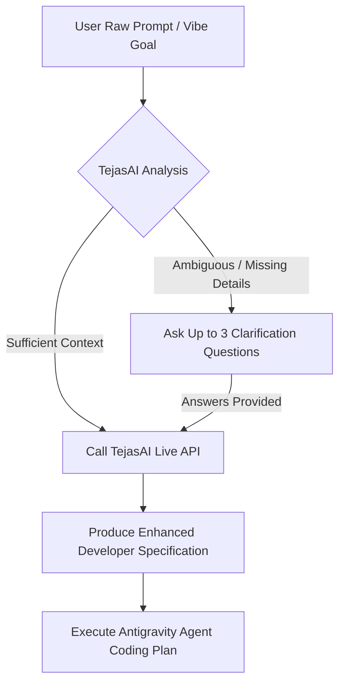

# TejasAI Vibe-Coding Prompt Enhancement Skill

This skill teaches the Antigravity agent how to refine, structure, and optimize coding prompts before launching long-running tasks, architecture generations, or complex refactors.

## When to Activate

Activate this skill when:
1. The user asks to **"enhance my prompt"**, **"make this prompt better"**, or **"clarify what to build"**.
2. The user provides a short or informal vibe-coding request (e.g. *"build an auth system"*, *"fix the race condition"*, *"write tests for checkout"*) and would benefit from a structured, production-grade specification before writing code.
3. The user wants to reuse or store proven developer prompt templates (feature development, debugging, code generation, refactoring, testing).

## Integration Workflow

### 1. Pre-Enhancement Intent Check
Before jumping into code edits, verify if the user's intent is sufficiently specified:
- Call `tejasai_analyze_clarify` to inspect whether core constraints, technologies, or edge cases are missing.
- If the model returns clarification questions, ask them cleanly (up to 3 questions max).

### 2. Live Prompt Enhancement
- Call `tejasai_enhance_prompt` with the user's input.
- Show the enhanced prompt clearly, highlighted with its improvement rationale:
  - Contextual constraints added
  - Architecture and type safety guardrails
  - Verification & testing plan

### 3. Developer Workflow Templates
Use `tejasai_get_developer_template` when starting from scratch on:
- **Feature Development**: Architecture specs, REST/GraphQL endpoints, state flows.
- **Debugging**: Root-cause analysis, stack trace isolation, race condition fixes.
- **Code Generation**: Clean functions, accessible UI components, service abstractions.
- **Refactoring**: SOLID decoupling, legacy modernization, performance tuning.
- **Testing**: End-to-end integration test suites, boundary fuzzing, mock isolation.

### 4. Reusing Favorites
Users can save proven prompts to their personal catalog using `tejasai_manage_favorites(action: 'save')` and list them at any time with `tejasai_manage_favorites(action: 'list')`.
